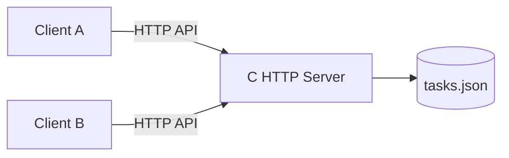
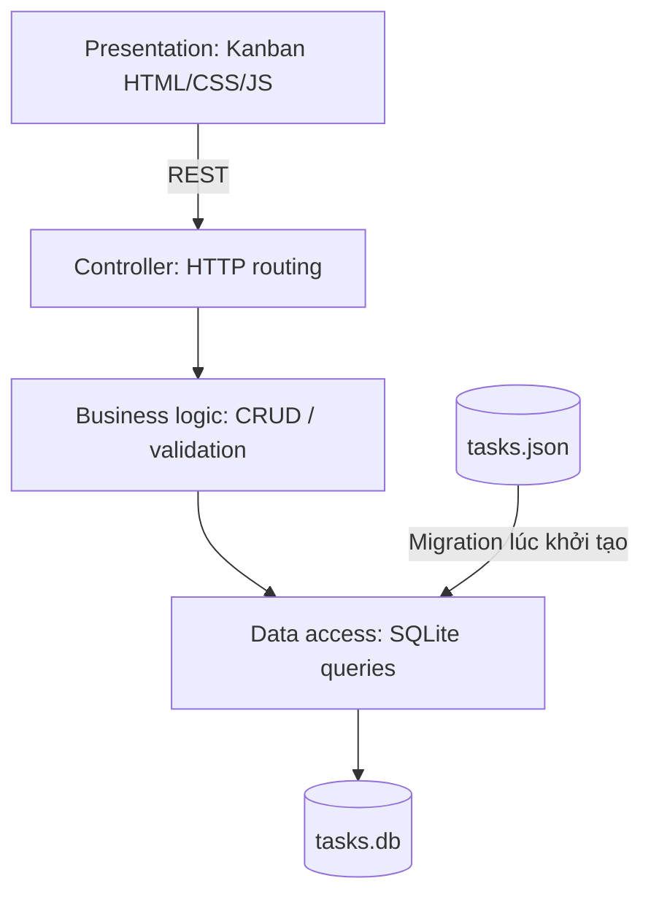

# Todo App

Ứng dụng quản lý công việc theo đề bài tuần 7, **một codebase** chạy ở ba chế độ. Backend viết bằng **C11**, HTTP dùng POSIX sockets và pthreads, JSON dùng **json-c**, database dùng **SQLite3**, giao diện HTML/CSS/JavaScript.

## Cài đặt (Ubuntu/WSL)

```bash
sudo apt update
sudo apt install build-essential libjson-c-dev libsqlite3-dev curl
make
```

Chạy các phiên bản (dừng server bằng Ctrl+C trước khi đổi chế độ):

```bash
make v1  # http://localhost:8080 - JSON, một client, giao diện danh sách
make v2  # http://localhost:8080 - JSON, nhiều client, polling 2.5 giây
make v3  # http://localhost:8080 - SQLite, Kanban hai cột, polling 2.5 giây
```

Có thể đổi cổng: `./task-manager --version 3 --port 8090`.

**Windows:** khuyến nghị WSL Ubuntu. Source HTTP sử dụng POSIX sockets nên không biên dịch trực tiếp với MSVC nếu chưa port sang Winsock.

## Luồng tiến hóa

- **V1:** REST CRUD + `data/tasks.json`, một trình duyệt. Dữ liệu còn sau restart.
- **V2:** Cùng backend trên LAN (bind `0.0.0.0`), hai trình duyệt gọi chung API; polling cập nhật định kỳ. Truy cập máy khác bằng `http://IP_MAY_CHU:8080` nếu firewall cho phép. Không có phân quyền; chỉ chạy trong mạng tin cậy.
- **V3:** Presentation chuyển thành Kanban, storage đổi sang `data/tasks.db` (SQLite). Lần đầu chạy V3, bảng `tasks` được tạo và dữ liệu `data/tasks.json` được nhập vào SQLite **nếu bảng đang rỗng**. File JSON gốc được giữ nguyên để đối chiếu. Khi đã có dữ liệu SQLite, JSON không được nhập lại.

**Lưu ý:** Sau khi chạy V3, nếu quay lại V2 và sửa JSON thì những thay đổi mới **không tự động đồng bộ** vào SQLite. Nên chụp bằng chứng V1/V2 trước khi chuyển V3. Nếu cần làm lại migration, sao lưu rồi xóa `data/tasks.db` trước khi chạy V3.

## API (không thay đổi qua các phiên bản)

| Method | URL | Body | Mục đích |
|---|---|---|---|
| GET | `/api/tasks` | — | Danh sách |
| POST | `/api/tasks` | `{"title":"Tên task"}` | Tạo task |
| PATCH | `/api/tasks/1` | `{"completed":true}` | Đổi trạng thái |
| DELETE | `/api/tasks/1` | — | Xóa task |
| GET | `/api/version` | — | Xem chế độ |

## Kiểm chứng

1. **V1:** Tạo hai task, đánh dấu hoàn thành một task, dừng và khởi động lại V1; xác nhận dữ liệu còn.
2. **V2:** Mở hai cửa sổ trình duyệt; A tạo task, B thấy sau tối đa khoảng 2.5 giây; B cập nhật, A thấy trạng thái mới.
3. **V3:** Dừng V2, khởi động V3; kiểm tra task V2 đã được nhập; thêm task ở cột chưa hoàn thành, đánh dấu chuyển sang hoàn thành, xóa, reload và khởi động lại để kiểm tra persistence.

Chạy kiểm thử tự động: `bash scripts/test.sh` (sử dụng cổng 18080; yêu cầu `curl` và `python3`).

## Sơ đồ kiến trúc V2



## Sơ đồ kiến trúc V3



**Phạm vi kiến trúc:** Đây là một bản thực hành tối giản. Controller, nghiệp vụ và truy cập dữ liệu được chia thành các hàm riêng trong `src/main.c`, **chưa tách thành các file/layer độc lập**. Vì vậy chưa thể coi là N-Layer tách biệt hoàn chỉnh. Để mở rộng, chuyển các hàm `create_task`, `list_tasks`, `modify_task` sang `task_service.c` và các hàm SQL/JSON sang repository riêng, giữ nguyên HTTP API.

## Nhật ký quyết định

| Version | NFR | Quyết định | Thay đổi | Kiểm thử |
|---|---|---|---|---|
| V1 | Lưu bền | JSON ở backend | `src/main.c`, `data/tasks.json` | CRUD + restart |
| V2 | Chia sẻ trạng thái | HTTP đa client + polling | `public/app.js`, server đa luồng | A tạo, B thấy |
| V3 | Dễ thay UI/persistence | Kanban + SQLite + migration | `public/*`, hàm lưu trữ trong `src/main.c`, `data/tasks.db` | Migration + CRUD + restart |

## Giới hạn

- Chỉ phục vụ bài tập trên mạng tin cậy, không có xác thực, TLS hoặc xử lý đầy đủ mọi trường hợp HTTP.
- JSON được khóa bằng mutex giữa các request trong cùng process; không hỗ trợ nhiều server process cùng ghi file.
- Migration chỉ tự động khi bảng SQLite rỗng. Cần sao lưu dữ liệu trước khi thử nghiệm lại.
- Không thực hiện V4/P2P.
#
